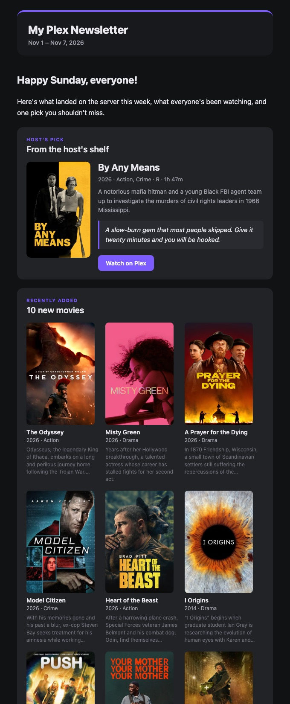
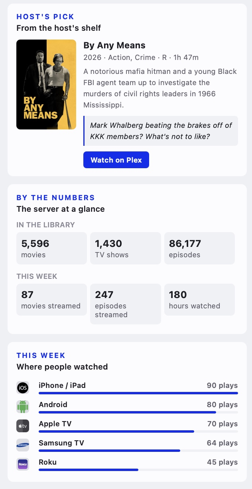

# Newzlettr

**Self-hosted newsletters for your Plex server, built on Tautulli.**

Newzlettr emails your Plex users what's new on your server: recently added movies and episodes,
what everyone's been watching, a featured "Host's Pick", and anything else you want to say. It
looks and sets up like the *arr apps (Sonarr, Radarr, Bazarr): one container, one `/config`
folder, a sidebar UI, Settings pages with **Test** buttons, and System pages for status, tasks,
logs and backups.

> **v2** is a full rebuild. Coming from v1? See [Upgrading from v1](#upgrading-from-v1).


| Dark email | Light email |
| --- | --- |
|  |  |


## Features

**Newsletters**
- **Templates with live cards** — write your intro in a rich-text editor and drop in cards:
  New movies, New episodes (grouped by show), Server totals, Most watched / Popular movies and
  shows, Platforms, Host's Pick. The preview is built by the same renderer that sends the email.
- **A look per newsletter** — Dark, Light, or *Match reader's device*, plus accent colour, header
  title and footer. Your Weekly can be dark and your Donation Drive light.
- **Schedules** — daily, weekly, monthly or any cron expression, in your time zone. Each
  scheduled slot can only ever send once; a send missed while Newzlettr was down is recorded,
  not sent late.
- **Send test / Send now / Preview** for every newsletter, and **Activity** — every send
  recorded: when, to how many, and any error.

**Recipients**
- **Import from Plex** — pulls in everyone your server is shared with and shows each person's
  **library access** (which libraries they have, or none).
- **Lists** — group people (Family, Friends without libraries…) and send newsletters to lists,
  individual people, or everyone.
- **Ignore list** — like Sonarr's import exclusions: ignored people are skipped by future imports.

**Everything else**
- **Stats page** — library totals, what's been watched, top platforms.
- **Privacy** — leave the server owner's (or anyone's) plays out of the *Most watched* lists.
- **Images** — attach posters to the email, or host them on Cloudinary (each image uploaded once,
  email-sized), with an account **usage** panel.
- **Login** — forms login, optional "Disabled for Local Addresses", and an API key.
- **Health checks, tasks, logs, backups** — like the *arr apps.

## Install (Docker)

Images are published for **x86 (amd64)** and **ARM (arm64)** — Intel/AMD servers, Synology,
Unraid, Raspberry Pi 4/5, Apple Silicon.

```bash
docker run -d --name newzlettr \
  -p 3001:3001 \
  -e TZ=America/New_York \
  -e PUID=1000 -e PGID=1000 \
  -v /path/to/newzlettr/config:/config \
  --restart unless-stopped \
  ghcr.io/jeff-blep/newzlettr:latest
```

or with Compose:

```yaml
services:
  newzlettr:
    image: ghcr.io/jeff-blep/newzlettr:latest
    container_name: newzlettr
    ports:
      - "3001:3001"
    environment:
      - TZ=America/New_York   # schedules use this zone (or set one in Settings > General)
      - PUID=1000             # files in /config are owned by this user/group
      - PGID=1000
    volumes:
      - ./config:/config
    restart: unless-stopped
```

Tags: `latest` (newest release), `2`, `2.0`, `2.0.0` (pin a version), `edge` (latest code on `main`).
To build it yourself instead: `docker build -t newzlettr .`

### First run

1. Open `http://<host>:3001` and create your admin account.
2. **Settings → Connections** — Plex URL + token, Tautulli URL + API key. Press **Test**.
3. **Settings → Email** — your SMTP server. Press **Test** (optionally send yourself a test email).
4. **Recipients → People → Import from Plex**, then put people on **Lists**.
5. **Templates → New Template**, then **Newsletters → New Newsletter**: pick the template, look,
   schedule, history window and recipients. Use **Send test** before switching it on.

Everything persistent lives in `/config`: the database (`newzlettr.db`), `logs/`, and `backups/`.
Nothing needs to be created beforehand. Pick your time zone in **Settings → General** (or set
`TZ`) — otherwise schedules run on the container's clock, which is UTC by default.

### Gmail

Use `smtp.gmail.com`, port 587, STARTTLS, your address as username, and an
[App Password](https://myaccount.google.com/apppasswords) (not your normal password).

### Light and dark email

Each newsletter goes out as one email to everyone. **Dark** and **Light** send that design.
**Match reader's device** sends the light design with instructions to switch to dark when the
reader's device is in dark mode — Apple Mail (iPhone, iPad, Mac), Outlook for Mac/iOS and others
follow them; Gmail doesn't (it shows light, and the Gmail app may recolour emails itself).

## Upgrading from v1

v2 uses a database instead of four JSON files. In **System → Backup → Import from Newzlettr v1**,
select your v1 `config.json`, `recipients.json`, `emailtemplates.json` and `newsletters.json`.
Settings, recipients, templates (old card tokens keep working), newsletters and the Host's Pick are
imported. **Newsletters are imported disabled** so nothing sends until you switch them on — open
each one to set its recipients (lists or people) and look before enabling it.

## Development

Requires Node 22.13+ (uses the built-in `node:sqlite`).

```bash
npm install
npm run dev        # API on :3001 (data in ./config), UI on http://localhost:5173
npm test           # vitest
npm run typecheck
npm run build && NEWZLETTR_CONFIG_DIR=./config npm start
```

Setting `NEWZLETTR_REDIRECT_ALL_MAIL_TO=you@example.com` sends **every** email to that one
address instead (with the intended audience size in the subject) — useful for testing against a
real recipient list. Never set it in production.

Layout: `server/` (Express 5 + TypeScript), `web/` (React + Mantine), `shared/types.ts`.

## License

[MIT](LICENSE)
