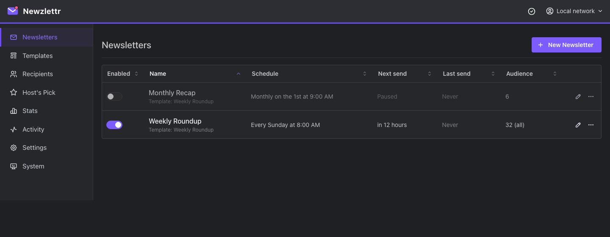
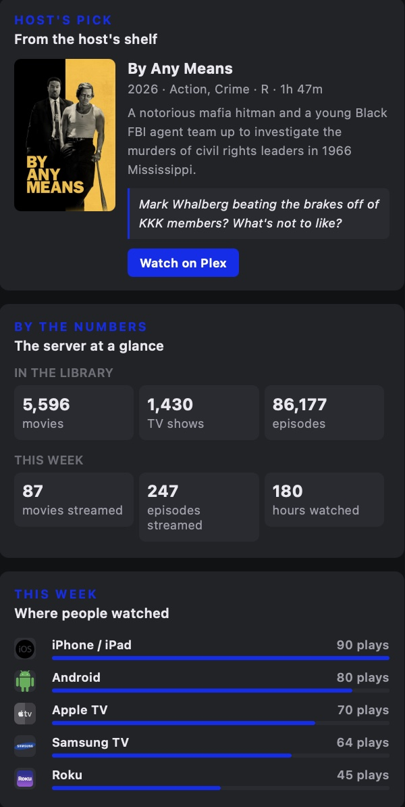
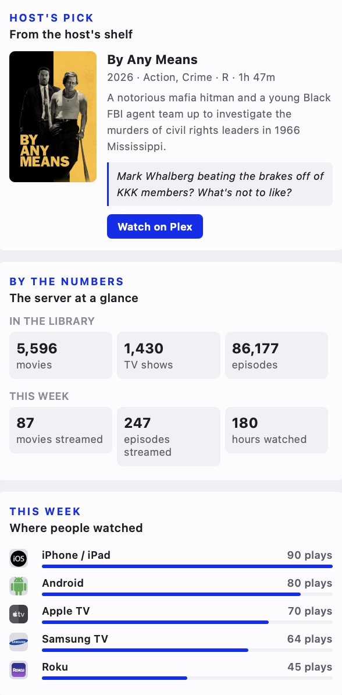
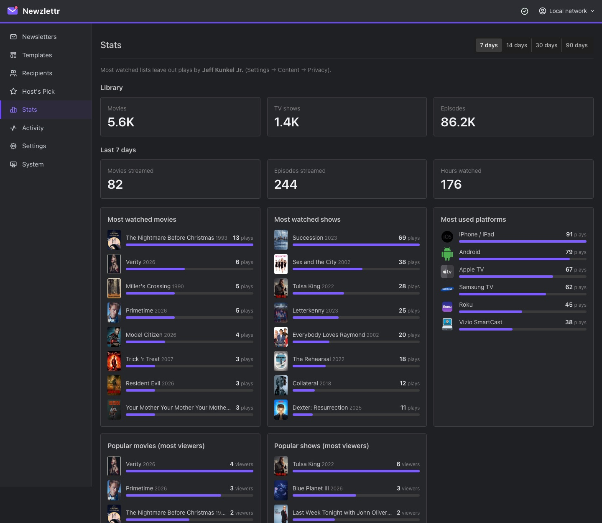

# Newzlettr

**Send your Plex users a good-looking newsletter about what's on your server.**

Newzlettr emails the people you share your Plex server with: the movies and episodes you've added,
what everyone's been watching, a "Host's Pick" with your own recommendation, and anything else you
want to say. Set it up once, pick a schedule, and it goes out on its own. If you've used Sonarr or
Radarr, it'll feel familiar.

> **v2** is a full rebuild. Coming from v1? See [Upgrading from v1](#upgrading-from-v1).



| Dark email | Light email |
| --- | --- |
|  |  |



## Features

**Newsletters**
- **Easy templates** — write your message like a normal email, then drop in ready-made sections:
  new movies, new episodes, most watched, most popular, server totals, Host's Pick and more. The
  preview shows exactly what people will get.
- **Your look** — each newsletter can be dark, light, or match the reader's phone/computer, with
  your own colour, title and footer.
- **Schedules** — daily, weekly or monthly, in your time zone. A newsletter never goes out twice,
  and one missed while the server was off won't show up late.
- **Preview, send a test to yourself, or send now** — and an **Activity** page showing every
  newsletter sent, to how many people, and whether anything went wrong.

**Recipients**
- **Import from Plex** — adds everyone you share your server with, and shows who has access to
  which libraries.
- **Lists** — put people into groups (Family, Friends…) and send to a list, a few people, or
  everyone.
- **Ignore list** — people you delete can stay out of future imports.

**Everything else**
- **Stats page** — library totals, what's been watched, and what people watch on.
- **Privacy** — keep your own viewing (or anyone's) out of the *Most watched* lists.
- **Telegram notifications** — get a message when a newsletter goes out, fails, or is skipped.
- **Posters** — attached to the email, or hosted on Cloudinary for smaller emails.
- **Password protected**, with health checks, logs and backups built in.

## Before you start

You'll need:

- **Plex Media Server** — and your [Plex token](https://support.plex.tv/articles/204059436-finding-an-authentication-token-x-plex-token/).
- **[Tautulli](https://tautulli.com)** — connected to your Plex server. Newzlettr gets its "what's
  been watched" numbers from it. You'll need its address and API key (Tautulli → Settings → Web
  Interface → API).
- **An email account to send from** — almost any provider works (see [Email](#email)).
- **Docker** — to run Newzlettr.
- **[Cloudinary](https://cloudinary.com)** *(optional)* — a free account hosts the poster images
  so the emails stay small. Without it, posters are attached to each email instead.
- **[Telegram](https://telegram.org)** *(optional)* — if you'd like a message when a newsletter
  goes out or something goes wrong.

## Install

Newzlettr runs in Docker on just about anything: a Windows/Linux PC, Mac, Synology, Unraid or
Raspberry Pi.

```bash
docker run -d --name newzlettr \
  -p 3001:3001 \
  -e TZ=America/New_York \
  -e PUID=1000 -e PGID=1000 \
  -v /path/to/newzlettr/config:/config \
  --restart unless-stopped \
  ghcr.io/jeff-blep/newzlettr:latest
```

or with Docker Compose:

```yaml
services:
  newzlettr:
    image: ghcr.io/jeff-blep/newzlettr:latest
    container_name: newzlettr
    ports:
      - "3001:3001"
    environment:
      - TZ=America/New_York   # your time zone, so newsletters go out at the right time
      - PUID=1000             # the user/group that owns the config folder
      - PGID=1000
    volumes:
      - ./config:/config      # where Newzlettr keeps everything
    restart: unless-stopped
```

All your settings, recipients and newsletters live in that one `config` folder. Back it up and
you've backed up everything.

### Setting it up

1. Open `http://<your-server>:3001` and create your login.
2. **Settings → Connections** — enter your Plex address and token, and your Tautulli address and
   API key. Press **Test** on each.
3. **Settings → Email** — enter your email account details and press **Test**
   (see [Email](#email)).
4. **Settings → Images** *(optional)* — choose Cloudinary and enter your account details.
5. **Settings → Notifications** *(optional)* — set up Telegram messages
   (see [Notifications](#notifications)).
6. **Recipients → People → Import from Plex**, then put people on **Lists** if you like.
7. **Templates → New Template** to write your newsletter, then **Newsletters → New Newsletter**
   to pick the template, look, schedule and who gets it. Send yourself a test before turning it on.

### Email

Newzlettr sends through your own email account. You'll need four things from your email provider —
search "*your provider* SMTP settings" if you're not sure:

- **Server** — e.g. `smtp.yourprovider.com`
- **Port and encryption** — usually 587 with STARTTLS, or 465 with SSL/TLS
- **Username** — usually your full email address
- **Password** — many providers (Gmail, iCloud, Yahoo, Outlook with two-step sign-in) require an
  **app password** made in your account's security settings, not your normal password

Use **Send Test Email** on the Email settings page to make sure it works.

### Notifications

Newzlettr can send you a Telegram message about your newsletters. Turn on any mix of:

- **Sent** — a newsletter went out, and to how many people
- **Failed** — a newsletter didn't send, or some people didn't get it (with the reason)
- **Skipped** — a scheduled newsletter was skipped because Newzlettr was off at the time

To set it up:

1. In Telegram, message [@BotFather](https://t.me/BotFather), send `/newbot`, and copy the
   token it gives you.
2. Open your new bot and press **Start** (or add it to a group), so it's allowed to message you.
3. Get your chat ID by messaging [@userinfobot](https://t.me/userinfobot).
4. In **Settings → Notifications**, paste the token and chat ID, turn on **Enable**, pick which
   messages you want, and press **Send Test Message**.

Test emails never send a notification. If you fill in **Application URL** in Settings → General,
each message includes a link to the Activity page.

### Dark, light, or match the reader

**Dark** and **Light** send that design to everyone. **Match reader's device** switches between
the two based on the reader's phone or computer setting. Apple Mail and Outlook on Mac/iPhone
follow it; Gmail doesn't, so Gmail readers see the light version.

## Updating

Updating replaces the app and keeps your `config` folder, so your settings, recipients and
newsletters stay exactly as they are.

**Docker Compose** — from the folder with your `docker-compose.yml`:

```bash
docker compose pull
docker compose up -d
```

**docker run** — pull the new image, remove the old container, then run your original
`docker run` command again with the same `/config` folder:

```bash
docker pull ghcr.io/jeff-blep/newzlettr:latest
docker stop newzlettr && docker rm newzlettr
docker run -d --name newzlettr ...   # the same command you installed with
```

**Other setups:**

- **Unraid** — on the Docker tab, click **Check for Updates**, then **Update** on Newzlettr.
- **Portainer** — open the container, choose **Recreate** and turn on **Pull latest image**.
- **Synology Container Manager** — under **Image**, choose **Update** when it says one is available.
- **Watchtower** — updates Newzlettr automatically; nothing to do.

To check it worked, look at the version under **System → Status**.

## Upgrading from v1

Go to **System → Backup → Import from Newzlettr v1** and select your four v1 files:
`config.json`, `recipients.json`, `emailtemplates.json` and `newsletters.json`. Your settings,
recipients, templates, newsletters and Host's Pick come across. Newsletters arrive **switched off**
so nothing sends by surprise — open each one, choose who gets it, then turn it on.

## For developers

Requires Node 22.13+.

```bash
npm install
npm run dev        # app on http://localhost:5173 (data in ./config)
npm test
npm run build && NEWZLETTR_CONFIG_DIR=./config npm start
```

Set `NEWZLETTR_REDIRECT_ALL_MAIL_TO=you@example.com` while testing to send **every** email to
that one address instead of real recipients. Never set it on a live server.

Image tags: `latest` (newest release), `2.0.0` etc. (a specific version), `edge` (newest code).
To build the image yourself: `docker build -t newzlettr .`

## License

[MIT](LICENSE)
